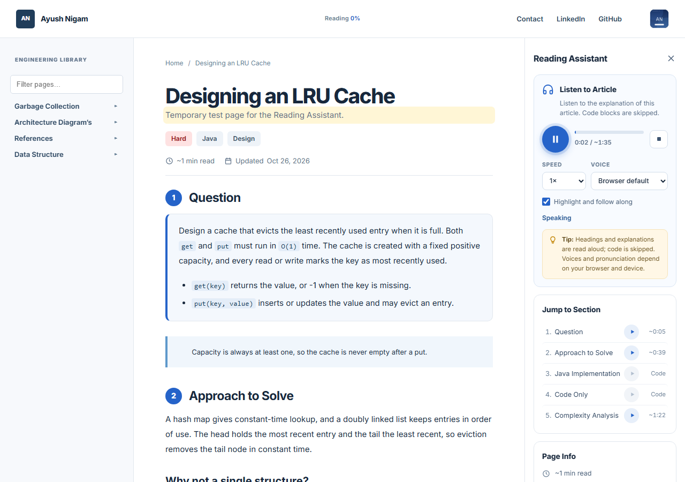
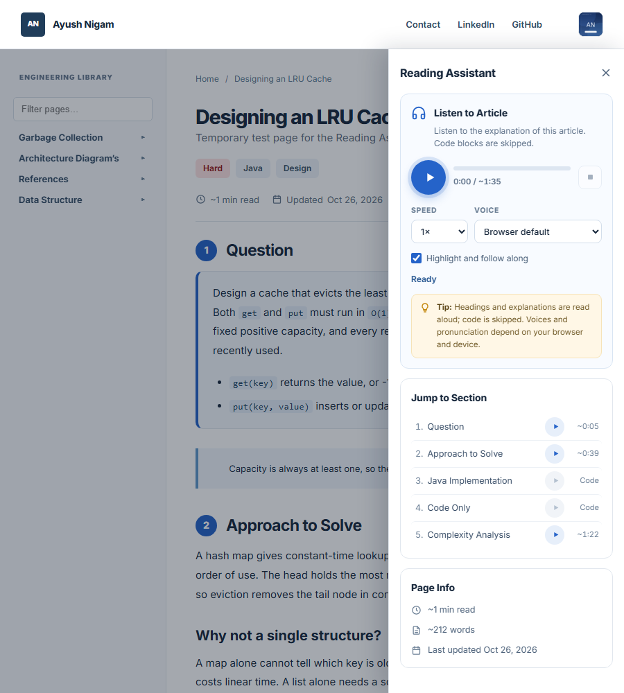
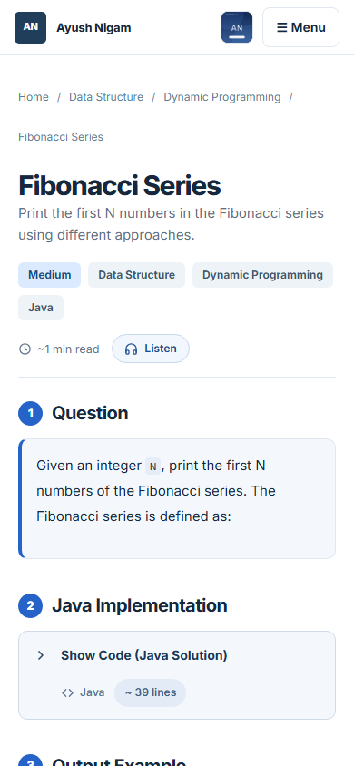
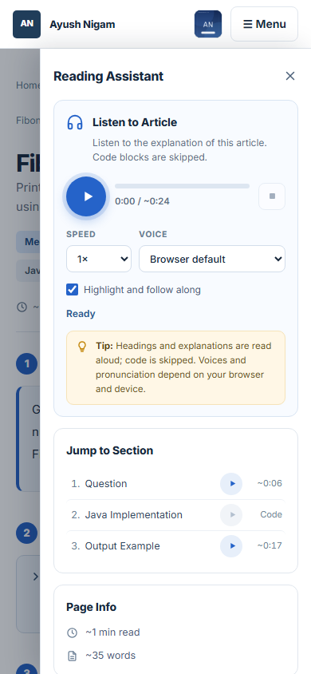

# Reading Assistant and reading progress

Every documentation article now gets:

- a slim **reading progress bar** under the sticky header, with a `Reading N%` label on wide screens
- a **`~N min read`** label and an optional **Updated** date under the title
- a right-hand **Reading Assistant** panel with **Listen to Article**, **Jump to Section**, and **Page Info**

Authors don't need to do anything. It works on ordinary `.adoc` pages with no HTML.



## Where it appears

| Page | Progress bar | Reading time | Assistant |
|---|---|---|---|
| Normal article (`default.hbs`) | yes | yes | yes |
| Site start page (`page.home`) | no | no | no (classic "On this page") |
| Portfolio layout, 404, header fragment | no | no | no |

## Author controls

These are valueless attributes in the page header. They're all opt-outs, because the defaults are on.

```asciidoc
= My Article
:page-no-reading-assistant:   // classic "On this page" panel instead
:page-no-listen:              // assistant without the Listen card (button reads "Sections")
:page-no-reading-progress:    // no progress bar
:page-no-reading-time:        // no "~N min read"
:page-revdate: 2026-10-26     // "Updated Oct 26, 2026" + Page Info; omit if you have no real date
```

Antora drops the `page-` prefix before the template sees these. `helpers/readingInfo.js` reads them as `no-listen`, `revdate` and so on. I tested each switch with a real build.

A date that isn't ISO (`YYYY-MM-DD`) is shown verbatim and gets no machine-readable `<time>`. Nothing is ever invented. Git-based dates aren't used, because CI checks out with `fetch-depth: 1`, so every file would show the same date.

To keep a passage out of narration without hiding it:

```asciidoc
[.no-narration]
This paragraph is shown but never read aloud.
```

## What is read aloud

The reading order is: title, subtitle, then each heading, paragraph, list item, definition-list term, table cell, and admonition (prefixed "Note:", "Tip:" and so on).

It **never** reads source code, `[%collapsible]` Show Code blocks (open or closed), literal blocks, callout lists, footnotes, chips, the meta row, breadcrumbs, the sidebar, the header, the panel itself, `[.no-narration]` content, or anything hidden.

A section that contains only code shows **Code** in Jump to Section, and its play button is disabled. During full-article playback, the voice says "Code example omitted." once per code run.

Some light notation fixes are applied: `O(N)` → "O of N", `2^N` → "2 to the power N", `->` → "to", `<=`, `!=`, and `=`. Pronunciation of generics, APIs and maths is **not** guaranteed.

## Honest limits (browser Web Speech API)

- **Times are estimates.** Speech engines report no duration and can't seek. Totals and section starts are shown as `~m:ss`, assuming about 160 words per minute at 1×. The meter isn't a scrubber.
- **Pause resumes from the start of the current sentence group** (≤160 characters). Native `pause()`/`resume()` is unreliable across browsers, so I didn't use it.
- **The voice is fixed; readers can't choose one.** The site asks for **Google UK English Male**, then any British English (`en-GB`) voice, then the browser's default. Google UK English Male only exists in desktop Chrome, so Edge, Firefox, Safari and phones use the fallback (for example, Edge picks a Microsoft UK voice). To change it, edit `PREFERRED_VOICE` in `js/reading-assistant.js`.
- **The default voice is cloud-backed.** When Google UK English Male is used, Chrome sends the text being read to Google to synthesise it. The articles are public, but readers on Chrome do send page text to Google. This site's own code never sends article text anywhere.
- Browsers without the Speech API show "Listening isn't available in this browser". Progress, Jump to Section and Page Info still work.
- Reading time assumes **220 words per minute** of prose. Code isn't counted.
- If you need an exact timeline or seeking, the upgrade is pre-generated MP3 per article played with `<audio>`. That isn't built.
- Summary and Notes tabs from the mock-up are **not implemented**. They aren't shown, so there are no dead tabs.

## Layout

| Width | Assistant |
|---|---|
| > 1180px | third column (300px, 320px at ≥1440px), sticky; × closes it, Listen button reopens (remembered) |
| ≤ 1180px, or phones sideways | slide-in drawer from the **Listen** button under the title; Escape, backdrop or × closes it |

On desktop, closing the panel stops speech. Closing the phone drawer doesn't, so you can keep listening while you read. Speed, follow-along and closed state are stored in `localStorage` under `reading-assistant:*`. A voice saved by the earlier voice picker is ignored.

## Files

| File | Role |
|---|---|
| `helpers/readingInfo.js` | Build-time word count, reading time, date, author switches |
| `partials/reading-assistant.hbs` | Panel markup (keeps class `docs-toc` so single-page navigation swaps it) |
| `layouts/default.hbs` | Progress bar, meta row, panel vs classic TOC, script order |
| `js/reading-assistant.js` | Progress bar, narration, panel and drawer |
| `js/site.js` | Calls `ReadingAssistant.refresh()` from `enhanceContent()`; swaps panel `id`/`aria-label` |
| `css/site.css` | `v20` section |

## Rebuild the bundle

```bash
python documentation/tools/build_ui_bundle.py \
  --source documentation/ui-source \
  --output gareeb-engineer/ui/engineering-portfolio-ui-header-fragment-fix.zip
antora antora-playbook.yml
python -m http.server 8000 --directory build-output   # test over http, not file://
```

`documentation/ui-source/` is the source of truth. The zip is generated from it.

## Test results (October 2026)

A clean Antora 3.1.10 build produces no warnings. I ran 60 automated checks in headless Chrome against the served site, and all passed. Speech was replaced by a recording mock because headless Chrome has no voices, so these checks verify **what** would be spoken and in what order:

- Progress bar: 0 → partial → 100, recalculates when Show Code opens or closes, works after single-page navigation, hidden on the start page and with the opt-out.
- Narration: title and subtitle first; no code, opt-out text, chips or interface text; "Code example omitted" once per code section; chunks ≤160 characters; only one utterance at a time.
- Play, pause, resume and stop; five rapid clicks give a single session; switching sections cancels the previous one; section play reads only that section.
- Single-page navigation cancels speech and rebuilds the panel. Going to the start page restores the classic TOC, and Back restores the assistant.
- No Speech API: controls hidden, message shown, jump links kept.
- All author switches checked.
- Tablet (900px) drawer: opens below the header, focus moves in, Escape closes it and returns focus. Phone (390px): no horizontal overflow; opening the nav menu closes the assistant drawer.
- Reduced motion: no animation. No console errors and no failed asset requests.

**Not verified:** real speech output and voice quality on a physical device; Firefox, Safari, iOS and Android; screen reader behaviour (I checked the ARIA by inspection only, with no assistive-technology testing).

| Tablet drawer | Phone | Phone drawer |
|---|---|---|
|  |  |  |
